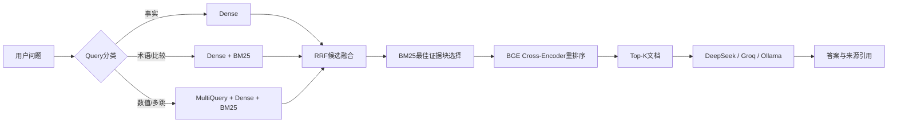

# Financial RAG System

面向金融财报的检索增强生成（RAG）系统。项目以 10-K 财报片段为主要语料，覆盖文档切分、向量索引、Dense/BM25 混合召回、RRF 融合、Cross-Encoder 重排序、自适应检索路由、答案生成与检索/生成双侧评估。

> 当前主要实验基于 FinanceBench。其 `corpus.jsonl` 是基准提供的财报相关段落，并非完整 10-K 原文。

## 项目亮点

- **金融领域语义检索**：使用 `FinLang/finance-embeddings-investopedia` 构建 Chroma 向量索引。
- **金融文本 BM25**：统一大小写和标点，并扩展 CAPEX、EBITDA、COGS、PP&E 等金融缩写。
- **候选融合与精排**：融合 Dense 与 BM25 候选，使用 `BAAI/bge-reranker-v2-m3` 对最佳证据块进行重排序。
- **自适应检索路由**：按照事实、术语、数值、比较和多跳问题选择 Dense、Hybrid 与 MultiQuery。
- **可复现评估**：检索侧支持 NDCG、Recall、Precision、MRR、Hit Rate，生成侧支持 RAGAS 评估和逐问题错误分析。
- **多种生成后端**：支持 DeepSeek、Groq 和本地 Ollama，答案可以携带 `[document_id]` 来源引用。

## 系统流程



### 自适应路由

问题类型由可解释的关键词和正则规则判断，不额外调用分类模型：

| Query 类型 | 检索策略 | MultiQuery |
|---|---|---:|
| 事实查询 | Dense | 否 |
| 金融术语 | Dense + BM25 | 否 |
| 比较问题 | Dense + BM25 | 否 |
| 数值计算 | Dense + BM25 | 是 |
| 多跳问题 | Dense + BM25 | 是 |

MultiQuery 使用 LLM 生成 3 个查询改写，并保留原始问题。不同 Query 的 Dense 排名与 BM25 排名通过 RRF 合并，最后仍由 Cross-Encoder 根据原始问题进行精排。

## 实验结果

评估使用 FinanceBench 中具有正相关 qrels 的 **45 个问题**。所有指标均按原始文档 ID 计算，未标注问题不会参与平均值。

### 最终检索结果

最终配置：Adaptive Retrieval、每路保留 Top-30 候选、最多 60 篇候选进入 BGE、输出 Top-10。

| NDCG@10 | Recall@10 | Precision@10 | MRR@10 | Hit Rate@10 |
|---:|---:|---:|---:|---:|
| **0.7606** | **0.9222** | **0.1222** | **0.7282** | **0.9333** |

### 检索消融实验

| 方案 | NDCG@10 | Recall@10 | MRR@10 | Hit Rate@10 |
|---|---:|---:|---:|---:|
| BM25 | 0.2626 | 0.4222 | 0.2204 | 0.4444 |
| Dense | 0.6589 | 0.8667 | 0.6038 | 0.8889 |
| 等权 RRF（无重排） | 0.4890 | 0.7000 | 0.4442 | 0.7556 |
| Dense@30 ∪ BM25@30 + BGE | 0.7461 | 0.9000 | 0.7221 | 0.9111 |
| Adaptive Retrieval + BGE | **0.7606** | **0.9222** | **0.7282** | **0.9333** |

Dense 是主要召回来源；BM25 单独使用时容易被重复的公司名、年份和财务术语干扰；将两路结果直接等权融合可能降低 Dense 的排序质量。更有效的做法是扩大候选并集，再由 Cross-Encoder 判断 Query 与证据块的真实相关性。

### 分类型结果

| Query 类型 | 数量 | 固定策略 Recall@10 | Adaptive Recall@10 |
|---|---:|---:|---:|
| 事实 | 20 | 0.9500 | 0.9500 |
| 数值 | 17 | 0.9118 | **0.9706** |
| 比较 | 4 | 1.0000 | 1.0000 |
| 术语 | 3 | 0.3333 | 0.3333 |
| 多跳 | 1 | 1.0000 | 1.0000 |

提升主要来自数值问题。此类问题经常需要同时定位多个计算要素，MultiQuery 能从不同表达角度补充候选。比较问题包含明确的年份和指标，查询改写可能弱化这些约束，因此不启用 MultiQuery。

### 生成侧结果

使用 DeepSeek 生成答案，并使用 RAGAS 评估：

| Faithfulness | Answer Relevancy | Context Utilization |
|---:|---:|---:|
| **0.7103** | **0.6412** | **0.8861** |

## 环境要求

- Python 3.12+
- Windows、Linux 或 macOS
- CPU 可以运行；推荐使用 NVIDIA GPU 加速 Embedding 和 BGE 重排序
- 完整问答、MultiQuery 和 RAGAS 需要相应的 LLM 服务；纯检索基线不需要 API Key

首次运行需要从 Hugging Face 下载：

- `FinLang/finance-embeddings-investopedia`，约 438 MB
- `BAAI/bge-reranker-v2-m3`，约 2.27 GB

## 安装

### 1. 创建虚拟环境

Windows PowerShell：

```powershell
py -3.12 -m venv .venv
.\.venv\Scripts\Activate.ps1
python -m pip install --upgrade pip
python -m pip install -e .
```

也可以使用 `uv`：

```powershell
uv sync
```

### 2. 检查计算设备

```powershell
.\.venv\Scripts\python.exe -c "import torch; print('PyTorch:', torch.__version__); print('CUDA:', torch.version.cuda); print('GPU available:', torch.cuda.is_available())"
```

如果显示 `GPU available: False`，当前安装的是 CPU 版 PyTorch，项目会自动使用 CPU。CUDA 版 PyTorch 需要根据显卡驱动和 PyTorch 官方安装说明单独安装，业务代码无需修改。

### 3. 配置生成模型（可选）

复制环境变量模板：

```powershell
Copy-Item .env.example .env
```

在 `.env` 中填写 DeepSeek Key：

```dotenv
DEEPSEEK_API_KEY=your_deepseek_api_key_here
DEEPSEEK_MODEL=deepseek-flash
```

`.env` 已被 Git 忽略，请勿提交真实 API Key。

## 快速开始

### 只运行检索，不需要 API Key

```powershell
.\.venv\Scripts\python.exe main.py `
  --dataset financebench `
  --no-multiquery `
  --top-k 10
```

该命令会完成切块、向量索引、BM25、融合与 BGE 重排序，最后打印 NDCG、Recall、Precision、MRR 和 Hit Rate。首次运行需要下载模型并构建 Chroma 索引，后续会复用 `chroma_stores/`。

### 复现最终 Adaptive Retrieval 配置

该配置的数值和多跳问题会调用 LLM 生成 MultiQuery，因此需要 API Key：

```powershell
New-Item -ItemType Directory -Force .\results | Out-Null

.\.venv\Scripts\python.exe main.py `
  --dataset financebench `
  --retrieval-mode adaptive `
  --candidate-top-k 30 `
  --rerank-top-n 60 `
  --top-k 10 `
  --save-results results\adaptive_routing_v2_top10.json
```

### 进行单模块消融

```powershell
# Dense only
.\.venv\Scripts\python.exe main.py --dataset financebench --retrieval-mode dense --no-multiquery --no-rerank --top-k 10

# BM25 only
.\.venv\Scripts\python.exe main.py --dataset financebench --retrieval-mode bm25 --no-multiquery --no-rerank --top-k 10

# Hybrid RRF，不使用Cross-Encoder
.\.venv\Scripts\python.exe main.py --dataset financebench --retrieval-mode hybrid --no-multiquery --no-rerank --top-k 10
```

### 提问并生成带引用的答案

```powershell
.\.venv\Scripts\python.exe main.py `
  --dataset financebench `
  --query "What was Apple's total net sales in fiscal 2022?" `
  --retrieval-mode adaptive `
  --candidate-top-k 30 `
  --rerank-top-n 60 `
  --provider deepseek
```

回答中的 `[document_id]` 对应检索语料的 `_id`，可以用于追溯来源。

## 生成侧评估

以下命令运行检索、答案生成和 RAGAS 评估，并逐条保存生成缓存：

```powershell
.\.venv\Scripts\python.exe eval.py `
  --dataset financebench `
  --config deepseek_hybrid_union30_bge `
  --n 45 `
  --top-k 10 `
  --retrieval-mode hybrid `
  --candidate-top-k 30 `
  --rerank-top-n 60 `
  --no-multiquery `
  --provider deepseek `
  --generation-cache results\deepseek_generation_cache.json `
  --details results\deepseek_ragas_details.csv
```

生成成功后会立即写入缓存。任务中断时重新执行相同命令，可以复用已经生成的答案。

## 错误分析

结合 RAGAS 明细、检索结果和 qrels 生成逐问题分析表：

```powershell
.\.venv\Scripts\python.exe analyze_errors.py `
  --dataset financebench `
  --details results\deepseek_ragas_details.csv `
  --retrieval-results results\adaptive_routing_v2_top10.json `
  --output results\financebench_error_analysis.csv
```

错误标签包括：

- `retrieval_miss`：Top-K 中没有标准相关文档
- `ranking_error`：相关文档存在，但排名在第 5 名之后
- `unsupported_claim`：生成内容缺乏上下文支持
- `answer_irrelevant`：回答与问题相关性不足
- `evidence_underused`：检索上下文没有得到充分利用

## 数据集

项目配置支持以下金融问答与检索数据集：

| 数据集 | 主要特点 |
|---|---|
| FinanceBench | 基于真实 10-K 财报的金融问题 |
| FinDER | 金融术语和缩写检索 |
| FinQABench | 财报问答事实性评估 |
| FinQA | 文本与表格多步推理 |
| TAT-QA | 文本与表格混合数值推理 |
| ConvFinQA | 多轮财务问答 |
| MultiHiertt | 层次化表格复杂推理 |

原始任务来源：[ICAIF-24 FinanceRAG Challenge](https://www.kaggle.com/competitions/icaif-24-finance-rag-challenge/overview)。使用或重新分发数据前，请确认对应数据集的许可证和竞赛条款。

## 目录结构

```text
Financial-RAG-System-main/
├── Dataset/                # corpus、queries和qrels
├── finrag/
│   ├── chunking.py         # 文档切分
│   ├── config.py           # 数据集与检索参数
│   ├── data.py             # JSONL和qrels加载
│   ├── vectorstore.py      # Chroma向量索引
│   ├── retrieval.py        # Dense、BM25、RRF和BGE重排序
│   ├── routing.py          # Query分类与自适应路由
│   ├── generation.py       # 答案生成与来源引用
│   ├── evaluation.py       # 检索指标
│   ├── ragas_eval.py       # 生成侧RAGAS评估
│   └── regression.py       # 实验结果记录与对比
├── main.py                 # 检索评估与单问题问答入口
├── eval.py                 # 生成侧评估入口
├── analyze_errors.py       # 分桶与错误样本分析
├── pyproject.toml          # Python依赖
├── uv.lock                 # 依赖锁文件
└── .env.example            # 环境变量模板
```

运行时生成的 `.venv/`、`chroma_stores/`、`results/` 和 `.env` 默认不会提交到 Git。

## 常用参数

| 参数 | 作用 |
|---|---|
| `--retrieval-mode dense` | 只使用 Dense 检索 |
| `--retrieval-mode bm25` | 只使用 BM25 检索 |
| `--retrieval-mode hybrid` | Dense 与 BM25 混合检索 |
| `--retrieval-mode adaptive` | 根据 Query 类型动态路由 |
| `--no-multiquery` | 禁用 LLM 查询改写 |
| `--no-rerank` | 禁用 BGE Cross-Encoder |
| `--candidate-top-k K` | 每路检索器在融合前保留的文档数 |
| `--rerank-top-n N` | 进入 Cross-Encoder 的候选文档数 |
| `--top-k K` | 最终返回及评估的文档数 |
| `--rebuild` | 强制重建 Chroma 索引 |
| `--save-results PATH` | 保存检索结果 JSON |

完整参数可通过以下命令查看：

```powershell
.\.venv\Scripts\python.exe main.py --help
.\.venv\Scripts\python.exe eval.py --help
```
